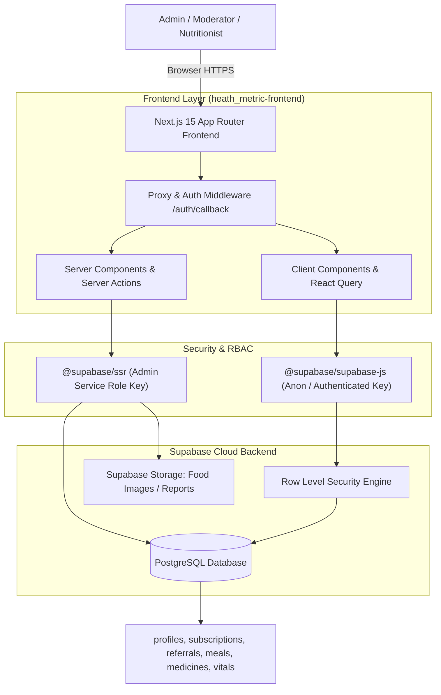
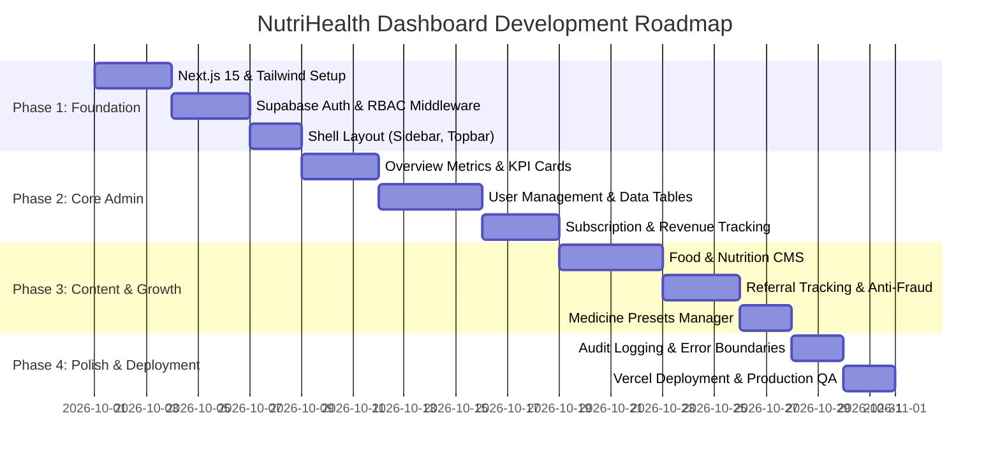

# 🏥 NutriHealth / HealthMetric - Admin & Operations Dashboard
## Comprehensive Architecture & Project Structure Plan

---

## 1. Executive Summary & Tech Stack

This document outlines the end-to-end architecture, folder structure, database integration, and feature modules for the **NutriHealth (Health Metric) Admin & Operations Web Dashboard**.

### 🛠️ Recommended Technology Stack

| Layer | Technology | Rationale |
| :--- | :--- | :--- |
| **Framework** | **Next.js 15+ (App Router)** | High performance, Server Actions for secure DB mutations, built-in SSR & SEO for admin portals. |
| **Language** | **TypeScript** | Strict type safety, shared interfaces with backend Supabase schema. |
| **Styling** | **Tailwind CSS v4** | Rapid, clean utility-first styling with modern dark/light mode tokens. |
| **UI Components** | **shadcn/ui + Radix UI** | Accessible, customizable, enterprise-grade tables, dialogs, dropdowns, and form inputs. |
| **Icons** | **Lucide React** | Lightweight, comprehensive icon system matching modern web design. |
| **Data Visualizations** | **Recharts** | Interactive charts for health vitals trends, MRR, user growth, and referral stats. |
| **State & Data Fetching** | **TanStack React Query v5** | Seamless caching, optimistic UI updates, background revalidation. |
| **Backend & Database** | **Supabase (PostgreSQL, Auth, Storage)** | Direct integration with existing mobile app database, Row Level Security (RLS) & Server-side Service Role. |
| **Form Management** | **React Hook Form + Zod** | Strict schema validation for data entry (CMS foods, user updates, subscription plans). |

---

## 2. System Architecture & Authentication Flow



---

## 3. Project Directory Structure

Below is the production-ready directory structure designed for scalability, maintainability, and clean separation of concerns using the **Next.js App Router (`src/` pattern)**:

```text
heath_metric-frontend/
├── .env.example
├── .env.local
├── .gitignore
├── next.config.mjs
├── package.json
├── postcss.config.mjs
├── tailwind.config.ts
├── tsconfig.json
├── README.md
├── plan.md                               # This master blueprint
│
├── public/                               # Static assets
│   ├── favicon.ico
│   ├── logo.svg
│   └── images/
│       ├── placeholder-food.png
│       └── avatars/
│
└── src/
    ├── app/                              # Next.js App Router (File-based Routing)
    │   ├── layout.tsx                    # Root layout with Providers (Theme, Query, Auth)
    │   ├── page.tsx                      # Root redirect (to /dashboard or /login)
    │   ├── not-found.tsx                 # 404 page
    │   ├── error.tsx                     # Global error boundary
    │   │
    │   ├── (auth)/                       # Authentication Route Group (Clean layout)
    │   │   ├── layout.tsx                # Centered auth card layout
    │   │   ├── login/
    │   │   │   └── page.tsx              # Admin sign-in with email/password + 2FA
    │   │   └── forgot-password/
    │   │       └── page.tsx              # Password reset flow
    │   │
    │   ├── (dashboard)/                  # Main Protected App Group (Sidebar + Header layout)
    │   │   ├── layout.tsx                # Dashboard shell (Sidebar, Topbar, Breadcrumbs)
    │   │   │
    │   │   ├── dashboard/                # 📊 Main Overview & Business Metrics
    │   │   │   └── page.tsx              # KPI cards, Live charts, Recent activity
    │   │   │
    │   │   ├── users/                    # 👥 User Management
    │   │   │   ├── page.tsx              # User directory table with pagination & filters
    │   │   │   └── [id]/
    │   │   │       ├── page.tsx          # User details: Profile, Family members, Subscriptions
    │   │   │       └── vitals/page.tsx   # Aggregated vitals history for specific user
    │   │   │
    │   │   ├── subscriptions/            # 💳 Subscription & Revenue Tracking
    │   │   │   ├── page.tsx              # Active subscriptions, churn rate, revenue graph
    │   │   │   └── plans/page.tsx        # Pricing tier configuration (Free, Pro, Lifetime)
    │   │   │
    │   │   ├── referrals/                # 🎁 Referral Program Management
    │   │   │   ├── page.tsx              # Referral conversion funnel, top ambassadors
    │   │   │   └── rewards/page.tsx      # Pending reward approvals & claim history
    │   │   │
    │   │   ├── cms-foods/                # 🥗 Food Database & "Can I Eat?" Rules
    │   │   │   ├── page.tsx              # Searchable list of food items & nutritional values
    │   │   │   ├── new/page.tsx          # Add food item with glycemic index, macros, guidelines
    │   │   │   └── [id]/edit/page.tsx    # Edit food details & condition safety flags
    │   │   │
    │   │   ├── medicines/                # 💊 Medicine Presets & Knowledgebase
    │   │   │   ├── page.tsx              # Master drug directory, dosage types, interactions
    │   │   │   └── new/page.tsx          # Add standard medicine preset
    │   │   │
    │   │   ├── health-analytics/         # 📈 Population Health Analytics (Anonymized)
    │   │   │   ├── blood-sugar/page.tsx  # Sugar reading distributions & trends
    │   │   │   ├── blood-pressure/page.tsx
    │   │   │   └── symptoms/page.tsx     # Frequency heatmaps of pain/symptom body regions
    │   │   │
    │   │   ├── team/                     # 🛡️ Admin Roles & Access Control (RBAC)
    │   │   │   ├── page.tsx              # Admin staff list, role assignment (Admin, Editor)
    │   │   │   └── logs/page.tsx         # Security audit log (who changed what & when)
    │   │   │
    │   │   └── settings/                 # ⚙️ Application Settings
    │   │       └── page.tsx              # App flags, notification broadcasts, maintenance mode
    │   │
    │   └── api/                          # Server API Handlers / Webhooks
    │       ├── auth/
    │       │   └── callback/route.ts     # Supabase Auth code exchange handler
    │       ├── export/
    │       │   ├── users/route.ts        # Export users CSV/Excel
    │       │   └── vitals/route.ts       # Export health reports
    │       └── webhooks/
    │           └── payments/route.ts     # In-app purchase / Stripe subscription sync webhook
    │
    ├── components/                       # Reusable UI & Business Components
    │   ├── ui/                           # Primitive shadcn/ui components
    │   │   ├── button.tsx
    │   │   ├── card.tsx
    │   │   ├── dialog.tsx
    │   │   ├── dropdown-menu.tsx
    │   │   ├── input.tsx
    │   │   ├── badge.tsx
    │   │   ├── table.tsx
    │   │   ├── tabs.tsx
    │   │   ├── select.tsx
    │   │   └── toast.tsx
    │   │
    │   ├── layout/                       # Shell components
    │   │   ├── sidebar.tsx               # Collapsible navigation menu
    │   │   ├── header.tsx                # Breadcrumbs, user dropdown, notification bell
    │   │   ├── mobile-nav.tsx            # Responsive mobile drawer
    │   │   └── theme-toggle.tsx          # Light/Dark mode switcher
    │   │
    │   ├── dashboard/                    # Overview widgets
    │   │   ├── metric-card.tsx           # Stat card with delta percentage
    │   │   ├── revenue-chart.tsx         # Line/Bar chart for MRR/ARR
    │   │   ├── user-growth-chart.tsx     # Area chart for daily active users
    │   │   └── recent-events.tsx         # Real-time event feed
    │   │
    │   ├── data-table/                   # Reusable Enterprise Data Table
    │   │   ├── data-table.tsx            # Core table with TanStack Table v8
    │   │   ├── data-table-pagination.tsx # Page size & navigation
    │   │   ├── data-table-toolbar.tsx    # Search input, facet filters, column visibility
    │   │   └── data-table-column-header.tsx # Sortable column headers
    │   │
    │   ├── users/                        # User specific cards & modals
    │   │   ├── user-status-badge.tsx
    │   │   ├── user-subscription-dialog.tsx
    │   │   └── user-ban-modal.tsx
    │   │
    │   └── cms/                          # Content management components
    │       ├── food-form.tsx             # Food creation & nutritional facts editor
    │       └── condition-tag-select.tsx  # Diabetes, Hypertension, Renal tags
    │
    ├── lib/                              # Utility functions, clients & configurations
    │   ├── supabase/
    │   │   ├── client.ts                 # Browser client (createBrowserClient)
    │   │   ├── server.ts                 # Server action/SSR client (createServerClient)
    │   │   ├── admin.ts                  # Elevated admin client using SUPABASE_SERVICE_ROLE_KEY
    │   │   └── middleware.ts             # Session refresh & route guard helper
    │   ├── utils.ts                      # Tailwind cn() merger, currency & date formatters
    │   ├── constants.ts                  # Nav links, user roles, default pagination sizes
    │   └── validators/                   # Zod Schemas
    │       ├── auth.schema.ts
    │       ├── food.schema.ts
    │       └── user.schema.ts
    │
    ├── hooks/                            # Custom React Hooks
    │   ├── use-debounce.ts               # Debounced search inputs
    │   ├── use-current-admin.ts          # Active logged-in admin & permissions
    │   └── use-toast.ts                  # UI toast dispatch hook
    │
    ├── types/                            # Global TypeScript Definitions
    │   ├── database.types.ts             # Auto-generated types from Supabase CLI
    │   ├── dashboard.types.ts            # Metric payloads, chart coordinates
    │   └── auth.types.ts                 # Admin roles: 'super_admin' | 'editor' | 'support'
    │
    └── middleware.ts                     # Next.js edge middleware for route protection
```

---

## 4. Key Functional Modules Breakdown

### Module A: Dashboard & Analytics Overview (`/dashboard`)
* **KPI Metrics:** Total registered users, active pro subscribers, Monthly Recurring Revenue (MRR), total vitals logged today, referral conversion rate.
* **Graphical Trends:** 
  * 30-day user registrations (Recharts Area Chart).
  * Subscription churn vs. upgrade distribution (Pie/Bar Chart).
  * System activity log (new user joins, high-risk vitals alerts, subscription upgrades).

### Module B: User & Dependent Directory (`/users`)
* **Features:**
  * Full-text search by name, email, or user ID.
  * Filter by subscription status (`free`, `monthly`, `annual`, `lifetime`).
  * Inspection of linked `family_members` (Managed Dependents).
  * Quick actions: Manual plan upgrade, password reset trigger, account suspension/activation.

### Module C: Subscription & Revenue Control (`/subscriptions`)
* **Features:**
  * Real-time sync with Supabase `subscriptions` table.
  * Plan performance breakdown (Revenue per plan tier).
  * Expiry date tracking and automated reminder/renewal monitoring.
  * Transaction history search.

### Module D: Referral Program & Fraud Detection (`/referrals`)
* **Features:**
  * Performance analytics for referral codes (most shared, highest conversions).
  * Fraud detection list: Duplicate IP / device checks, rapid self-referrals.
  * Claim reward system: Mark rewards as `rewarded` or `rejected`.

### Module E: Food & Nutrition CMS (`/cms-foods`)
* **Features:**
  * Manage foods used in the mobile app's *"Can I Eat?"* and *Daily Meal Planner* modules.
  * Standard nutritional facts: Calories, Carbohydrates, Protein, Fats, Fiber, Glycemic Index.
  * Condition tags: Safe for Diabetics (Type 1/2), Low Sodium (Hypertension), Gluten-Free, Renal-Friendly.
  * Medical / Dietary notes for mobile users.

### Module F: Role-Based Access Control (RBAC) & Team (`/team`)
* **Roles:**
  1. **Super Admin:** Full access (database mutation, team invites, payment configs).
  2. **Moderator / Support:** User lookup, subscription overrides, bug resolution (no deletion permissions).
  3. **Nutritionist / Content Editor:** Exclusively manages the Food & Medicine databases.
* **Audit Trail:** Logs every critical admin action with timestamp and IP.

---

## 5. Security & Supabase Integration Rules

1. **Service Role Key Security:**
   * `SUPABASE_SERVICE_ROLE_KEY` will **NEVER** be exposed to client-side components.
   * All elevated operations (banning users, modifying system tables) are executed strictly in Next.js **Server Actions** (`src/lib/supabase/admin.ts`).
2. **Session Guarding via Edge Middleware:**
   * The `middleware.ts` intercepts all requests to `/(dashboard)/*`.
   * Unauthenticated requests are instantly redirected to `/login`.
   * Users lacking admin claims or roles are rejected with a 403 Forbidden page.
3. **Environment Variables Config:**
   ```env
   # Public (Exposed to browser)
   NEXT_PUBLIC_SUPABASE_URL=https://your-project.supabase.co
   NEXT_PUBLIC_SUPABASE_ANON_KEY=your-anon-key
   NEXT_PUBLIC_APP_URL=http://localhost:3000

   # Secret (Server-side ONLY)
   SUPABASE_SERVICE_ROLE_KEY=your-secret-service-role-key
   ADMIN_PORTAL_SECRET=optional-session-salt
   ```

---

## 6. Phased Implementation Roadmap



---

## 7. Next Immediate Steps

When ready to initialize this dashboard codebase inside `heath_metric-frontend`:
1. Run `npx create-next-app@latest ./ --typescript --tailwind --eslint --app --src-dir`
2. Install shadcn/ui via `npx shadcn@latest init`
3. Install core dependencies:
   ```bash
   npm install @supabase/supabase-js @supabase/ssr @tanstack/react-query @tanstack/react-table lucide-react recharts zod react-hook-form
   ```
4. Set up `.env.local` using existing Supabase project credentials.
